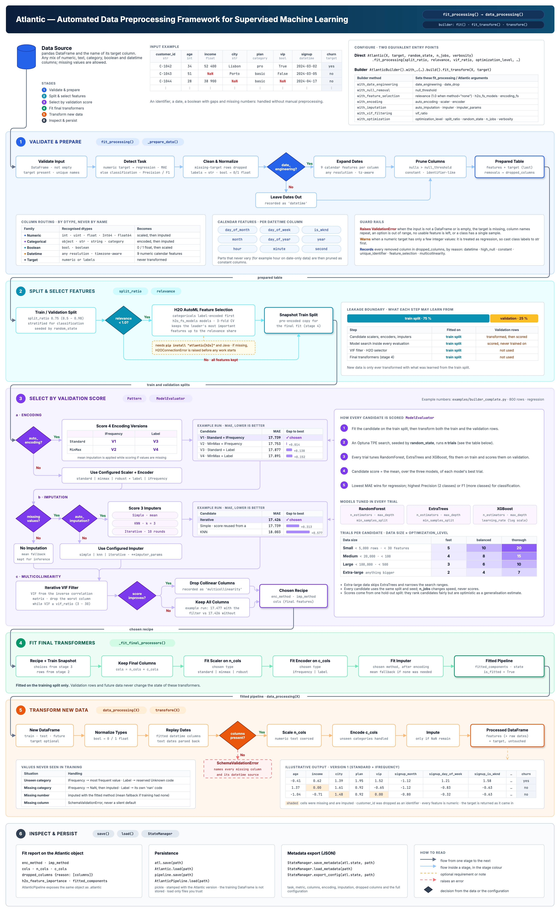

[![LinkedIn][linkedin-shield]][linkedin-url]
[![Contributors][contributors-shield]][contributors-url]
[![Stargazers][stars-shield]][stars-url]
[![MIT License][license-shield]][license-url]
[![Downloads][downloads-shield]][downloads-url]
[![Month Downloads][downloads-month-shield]][downloads-month-url]

[contributors-shield]: https://img.shields.io/github/contributors/TsLu1s/Atlantic.svg?style=for-the-badge&logo=github&logoColor=white
[contributors-url]: https://github.com/TsLu1s/Atlantic/graphs/contributors
[stars-shield]: https://img.shields.io/github/stars/TsLu1s/Atlantic.svg?style=for-the-badge&logo=github&logoColor=white
[stars-url]: https://github.com/TsLu1s/Atlantic/stargazers
[license-shield]: https://img.shields.io/github/license/TsLu1s/Atlantic.svg?style=for-the-badge&logo=opensource&logoColor=white
[license-url]: https://github.com/TsLu1s/Atlantic/blob/main/LICENSE
[linkedin-shield]: https://img.shields.io/badge/-LinkedIn-black.svg?style=for-the-badge&logo=linkedin&colorB=555
[linkedin-url]: https://www.linkedin.com/in/luisfssantos98/
[downloads-shield]: https://static.pepy.tech/personalized-badge/atlantic?period=total&units=international_system&left_color=grey&right_color=blue&left_text=Total%20Downloads
[downloads-url]: https://pepy.tech/project/atlantic
[downloads-month-shield]: https://static.pepy.tech/personalized-badge/atlantic?period=month&units=international_system&left_color=grey&right_color=blue&left_text=Month%20Downloads
[downloads-month-url]: https://pepy.tech/project/atlantic

<br>
<p align="center">
  <h2 align="center"> Atlantic - Automated Data Preprocessing Framework for Supervised Machine Learning
  <br>
  
## Framework Contextualization <a name = "ta"></a>

The `Atlantic` project constitutes a comprehensive and objective approach to simplify and automate data processing through the integration and validated application of various preprocessing mechanisms, ranging from feature engineering, automated feature selection, multiple encoding versions and null imputation methods. The optimization methodology of this framework follows an evaluation structured in tree-based model ensembles.

This project aims at providing the following application capabilities:

* General applicability on tabular datasets: The developed preprocessing procedures are applicable on multiple domains associated with Supervised Machine Learning, regardless of the properties or specifications of the data.

* Automated treatment of tabular data associated with predictive analysis: It implements a global and carefully validated data processing based on the characteristics of the data input columns.

* Robustness and improvement of predictive results: The implementation of the `atlantic` automated data preprocessing pipeline aims at improving predictive performance directly associated with the processing methods implemented based on the data properties.  
   
#### Main Development Tools <a name = "pre1"></a>

Major frameworks used to build this project: 
   
* [H2O.ai](https://docs.h2o.ai/h2o/latest-stable/h2o-docs/automl.html)
* [Scikit-learn](https://scikit-learn.org/stable/)
* [XGBoost](https://xgboost.readthedocs.io/en/stable/)
* [Optuna](https://optuna.org/)
* [Pandas](https://pandas.pydata.org/)

    
## Framework Architecture <a name = "ta"></a>

<p align="center">
  <a href="https://raw.githubusercontent.com/TsLu1s/atlantic/main/docs/Atlantic_Pipeline_Diagram.png">
    
  </a>
</p>

<p align="center"><sub>Click the diagram to open it at full resolution. Source: <a href="https://github.com/TsLu1s/atlantic/blob/main/docs/Atlantic_Pipeline_Diagram.drawio"><code>docs/Atlantic_Pipeline_Diagram.drawio</code></a> (editable in <a href="https://app.diagrams.net">diagrams.net</a>).</sub></p>

The Atlantic pipeline runs in six stages. **Validate & prepare** checks the input and infers the task from the target: a numeric target is a regression task scored by MAE, anything else a classification task scored by Precision (two classes) or F1 (more classes). It then drops rows without a target, turns boolean columns into 0/1 features, expands datetime columns into nine calendar features, and removes high-null, constant and identifier-like columns, recording every removal in `dropped_columns`. **Split & select features** creates a train/validation split (stratified for classification) and, when `relevance < 1.0`, keeps the features that carry the requested share of H2O AutoML variable importance. **Select by validation score** compares four scaler and encoder combinations, then three imputers (only when values are missing), and finally an iterative VIF filter that is kept only if it improves the validation score. Every candidate is fitted on the train split and scored on the validation split by tuned RandomForest, ExtraTrees and XGBoost models, with a trial budget that adapts to the data size and the `optimization_level`. **Fit final transformers** refits the chosen scaler, encoder and imputer on the training rows only, so validation rows never influence them. **Transform new data** (`data_processing`) replays the same steps on any future frame: it rejects frames that lack a fitted column with a clear error, and it handles unseen categories and missing values. Finally, the fitted pipeline can be inspected, saved and reloaded.

## Where to get it <a name = "ta"></a>

Binary installer for the latest released version is available at the Python Package Index [(PyPI)](https://pypi.org/project/atlantic/).  

## Installation  

To install this package from Pypi repository run the following command:
```
pip install atlantic
```

Feature selection with H2O AutoML is an optional component that needs the `h2o` package and a Java runtime. Install it with:
```
pip install "atlantic[h2o]"
```
Without it the rest of the pipeline works unchanged: pass `relevance=1.0` (or `with_feature_selection(method="none")` in the builder) to skip H2O feature selection. Requires Python 3.11+.

# Usage Examples
    
## 1. Atlantic - Automated Data Preprocessing Pipeline

Import the package, load a dataset, split it, and define your target column name. Customize the `fit_processing` method with the following parameters:

| Parameter | Description | Default |
|-----------|-------------|---------|
| `split_ratio` | Train/Validation split ratio for preprocessing evaluation (0.5 - 0.98) | 0.75 |
| `relevance` | Minimum feature importance percentage for H2O AutoML selection (0.4 - 1.0). `1.0` skips H2O feature selection; lower values require `atlantic[h2o]` | 0.99 |
| `h2o_fs_models` | Number of models for H2O AutoML feature selection | 7 |
| `encoding_fs` | Encode categorical features before H2O selection | True |
| `vif_ratio` | Variance Inflation Factor threshold (3 - 30) | 10.0 |
| `optimization_level` | Optimization intensity: `"fast"`, `"balanced"`, `"thorough"` | "balanced" |

The `Atlantic` constructor additionally accepts:

| Parameter | Description | Default |
|-----------|-------------|---------|
| `random_state` | Seed for the internal train/validation split and every model evaluation | 42 |
| `n_jobs` | Parallelism of the evaluation models. `None` keeps the tree ensembles single-threaded, `-1` uses all cores (same results, faster on mid-sized data) | None |
| `verbosity` | `0` silent, `1` selection summary, `2` detailed | 1 |

Once fitted, use `data_processing` to transform any future dataframes with the same structure.

> **Task type.** It is inferred from the target column: a numeric target is a regression task, anything else (strings, categories, booleans) a classification task. Integer-coded class labels such as `0`/`1` are therefore treated as regression (a warning is raised) - cast them first: `data["Target_Column"] = data["Target_Column"].astype(str)`.

```py
import pandas as pd
from sklearn.model_selection import train_test_split
from atlantic.pipeline import Atlantic
import warnings
warnings.filterwarnings("ignore", category=Warning)
    
data = pd.read_csv('csv_directory_path', encoding='latin', delimiter=',')

train, test = train_test_split(data, train_size=0.8)
test, future_data = train_test_split(test, train_size=0.6)

train = train.reset_index(drop=True)
test = test.reset_index(drop=True)
future_data = future_data.reset_index(drop=True)
future_data.drop(columns=["Target_Column"], inplace=True)

### Fit Data Processing
atl = Atlantic(X=train, target="Target_Column")    

atl.fit_processing(
    split_ratio=0.75,
    relevance=0.99,      # H2O feature selection (needs atlantic[h2o]); 1.0 skips it
    h2o_fs_models=7,
    vif_ratio=10.0,
    optimization_level="balanced"
)

### Transform Data Processing
train = atl.data_processing(X=train)
test = atl.data_processing(X=test)
future_data = atl.data_processing(X=future_data)

### Inspect what the pipeline decided
print(atl.enc_method, atl.imp_method)   # selected encoding version / imputation method
print(atl.cols)                         # feature columns kept
print(atl.dropped_columns)              # columns removed, grouped by reason

### Export the fitted pipeline (built-in helper — uses pickle under the hood)
### The training data is not stored in the file. Only load pipeline files you trust.
atl.save('fit_atl.pkl')
loaded_atl = Atlantic.load('fit_atl.pkl')

# Or serialize manually with dill (bundled dependency):
# import dill as pickle
# with open('fit_atl.pkl', 'wb') as output:
#     pickle.dump(atl, output)
```  

## 2. Atlantic - Builder Pattern (Granular Control)

For fine-grained control over preprocessing steps, use the `AtlanticBuilder` fluent interface:
```py
from sklearn.model_selection import train_test_split
from atlantic.pipeline import AtlanticBuilder

train, test = train_test_split(data, train_size=0.8)
train = train.reset_index(drop=True)
test = test.reset_index(drop=True)

### Build Custom Pipeline
pipeline = (AtlanticBuilder()
    .with_date_engineering(enabled=True, drop=True)
    .with_null_removal(threshold=0.90)
    .with_feature_selection(
        method="h2o",
        relevance=0.95,
        h2o_models=10,
        encoding_fs=True
    )
    .with_encoding(
        scaler="standard",
        encoder="ifrequency",
        auto_select=True
    )
    .with_imputation(
        method="knn",
        auto_select=True
    )
    .with_vif_filtering(threshold=10.0)
    .with_optimization(optimization_level="balanced")
    .build()
)

### Fit and Transform
train_processed = pipeline.fit_transform(train, target="Target_Column")
test_processed = pipeline.transform(test)

### Inspect the fitted result and persist the pipeline
print(pipeline.atlantic.enc_method, pipeline.atlantic.dropped_columns)
pipeline.save('fit_pipeline.pkl')
# from atlantic.pipeline import AtlanticPipeline
# pipeline = AtlanticPipeline.load('fit_pipeline.pkl')
```

Notes on the builder options:

* `with_date_engineering(enabled, drop)` - `enabled=False` leaves datetime columns out of the features; `drop=False` keeps the original datetime columns in the transformed output next to the generated features.
* `with_encoding(..., auto_select=True)` / `with_imputation(..., auto_select=True)` select the best option by validation performance and ignore the explicit `scaler` / `encoder` / `method`; with `auto_select=False` they are applied as given.
* `with_optimization(optimization_level, random_state, split_ratio, n_jobs, verbosity)` controls the evaluation budget, reproducibility and console output.

### Builder Configuration Presets

| Configuration | Use Case | Key Settings |
|--------------|----------|--------------|
| Fast | Quick prototyping | `h2o_models=3`, `method="simple"`, `optimization_level="fast"` |
| Balanced | General purpose | Default settings |
| Thorough | Best results | `h2o_models=15`, `method="iterative"`, `optimization_level="thorough"` |
| High-Null | Missing data >20% | `threshold=0.80`, `scaler="robust"`, `method="iterative"` |
| No-H2O | Skip H2O selection | `method="none"`, VIF filtering only |
```py
# Fast Prototyping
fast_pipeline = (AtlanticBuilder()
    .with_feature_selection(method="h2o", relevance=0.85, h2o_models=3)
    .with_encoding(scaler="minmax", encoder="label", auto_select=False)
    .with_imputation(method="simple", auto_select=False)
    .with_optimization(optimization_level="fast")
    .build()
)

# Thorough Optimization  
thorough_pipeline = (AtlanticBuilder()
    .with_feature_selection(method="h2o", relevance=0.98, h2o_models=15)
    .with_encoding(auto_select=True)
    .with_imputation(method="iterative", auto_select=True)
    .with_vif_filtering(threshold=8.0)
    .with_optimization(optimization_level="thorough")
    .build()
)

# High-Null Data
high_null_pipeline = (AtlanticBuilder()
    .with_null_removal(threshold=0.80)
    .with_encoding(scaler="robust")
    .with_imputation(method="iterative", auto_select=True)
    .build()
)
```

## 3. Atlantic - Preprocessing Components
    
### 3.1 Encoding Methods
 
Encode categorical variables into numerical format. Choose from label encoding (ordinal mapping) or inverse frequency encoding (IDF-based weights) — both preserve the column layout, so you can assign the result back in place. `AutoOneHotEncoder` **expands** each categorical column into several binary columns, so it returns a wider frame and must be handled separately (see the note below).

```py
import pandas as pd
from sklearn.model_selection import train_test_split 
from atlantic.preprocessing import AutoLabelEncoder, AutoIFrequencyEncoder, AutoOneHotEncoder

train, test = train_test_split(data, train_size=0.8)
train = train.reset_index(drop=True)
test = test.reset_index(drop=True)

from atlantic.utils import get_categorical_columns, get_numeric_columns

target = "Target_Column"
# Detects object, category and string dtype columns on any pandas version.
cat_cols = get_categorical_columns(data, exclude=[target])

### Create Encoder (label or inverse-frequency — same-shape output)
encoder = AutoLabelEncoder()
# encoder = AutoIFrequencyEncoder()

### Fit and Transform
encoder.fit(train[cat_cols])
train[cat_cols] = encoder.transform(train[cat_cols])
test[cat_cols] = encoder.transform(test[cat_cols])

### Inverse Transform (if needed)
train[cat_cols] = encoder.inverse_transform(train[cat_cols])

### One-hot encoding returns a WIDER frame — do not assign back into cat_cols:
# ohe = AutoOneHotEncoder()
# ohe.fit(train[cat_cols])
# train = ohe.transform(train)   # original cat_cols are replaced by binary columns
# test = ohe.transform(test)
```    

### 3.2 Scalers

Normalize numerical features to improve model convergence. Standard scaler for normal distributions, MinMax for bounded ranges, or Robust scaler for data with outliers.

```py
from atlantic.preprocessing import AutoStandardScaler, AutoMinMaxScaler, AutoRobustScaler
from atlantic.utils import get_numeric_columns

target = "Target_Column"
# Exclude the target: scaling the label column would distort it for regression.
num_cols = get_numeric_columns(train, exclude=[target])

### Create Scaler (choose one)
scaler = AutoStandardScaler()  # Zero mean, unit variance
# scaler = AutoMinMaxScaler()  # Scale to [0, 1]
# scaler = AutoRobustScaler()  # Median/IQR based, outlier-resistant

### Fit and Transform
scaler.fit(train[num_cols])
train[num_cols] = scaler.transform(train[num_cols])
test[num_cols] = scaler.transform(test[num_cols])
```

### 3.3 Imputers

Handle missing values using statistical methods. Simple imputation for speed, KNN for local patterns, or iterative modeling for complex dependencies.

```py
from atlantic.preprocessing import AutoSimpleImputer, AutoKNNImputer, AutoIterativeImputer

### Create Imputer (choose one)
imputer = AutoSimpleImputer(strategy='mean', target=target)
# imputer = AutoKNNImputer(n_neighbors=5, target=target)
# imputer = AutoIterativeImputer(max_iter=10, target=target)

### Fit and Transform
imputer.fit(train)
train = imputer.transform(train)
test = imputer.transform(test)
```

### 3.4 Feature Selection

Reduce dimensionality by removing redundant or low-importance features. VIF removes multicollinear features, while H2O AutoML identifies the most predictive ones.

> **Note:** `VIFFeatureSelector` evaluates numeric, null-free columns — impute nulls first (it raises `ValidationError` on nulls). Non-numeric columns are passed through untouched. `vif_threshold` must be within `[3.0, 30.0]`. The `H2OFeatureSelector` example below requires a running H2O cluster (Java); install the optional dependency with `pip install atlantic[h2o]`.

```py
from atlantic.feature_selection import VIFFeatureSelector, H2OFeatureSelector

### VIF-based Selection (expects encoded, imputed, numeric features)
vif_selector = VIFFeatureSelector(target=target, vif_threshold=10.0)
vif_selector.fit(train)
train = vif_selector.transform(train)
test = vif_selector.transform(test)

### H2O AutoML Selection
h2o_selector = H2OFeatureSelector(target=target, relevance=0.95, max_models=7)
h2o_selector.fit(train)
train = h2o_selector.transform(train)
test = h2o_selector.transform(test)
```

Check out the <a href="https://github.com/TsLu1s/atlantic/blob/main/examples/custom_preprocessing.py" style="text-decoration:none;">
    
</a> for detailed implementations of all preprocessing methods.

For interactive and step by step guideline walkthrough, feel free to explore the <a href="https://github.com/TsLu1s/atlantic/blob/main/examples/notebooks" style="text-decoration:none;">
    
</a>

## Citation
```bibtex
@article{SANTOS2023100532,
  author = {Luis Fernando Santos and Luis Ferreira},
  title = {Atlantic - Automated data preprocessing framework for supervised machine learning},
  journal = {Software Impacts},
  volume = {17},
  year = {2023},
  issn = {2665-9638},
  doi = {http://dx.doi.org/10.1016/j.simpa.2023.100532},
  url = {https://www.sciencedirect.com/science/article/pii/S2665963823000696}
}
```
    
## License

Distributed under the MIT License. See [LICENSE](https://github.com/TsLu1s/Atlantic/blob/main/LICENSE) for more information.

## Contact 
 
[Luis Santos - LinkedIn](https://www.linkedin.com/in/lu%C3%ADsfssantos/)
